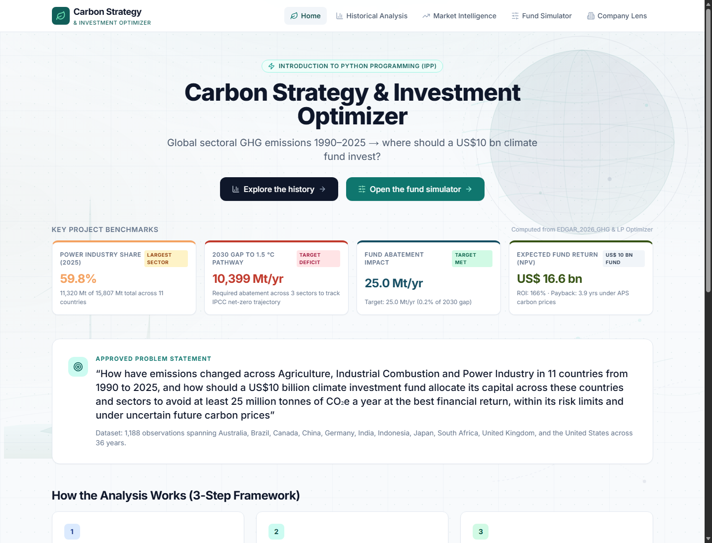
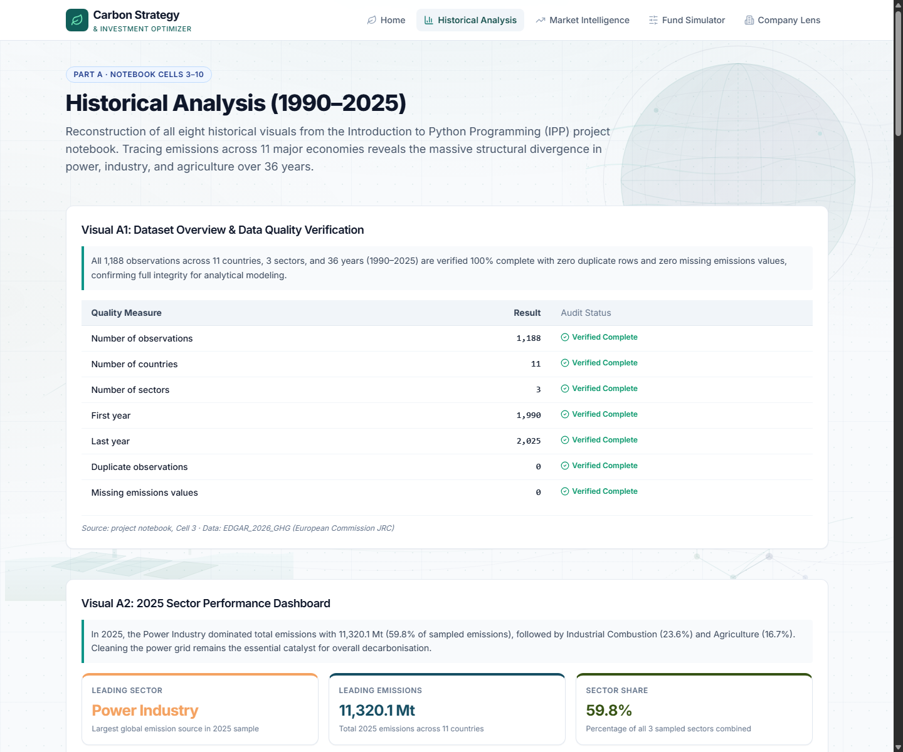
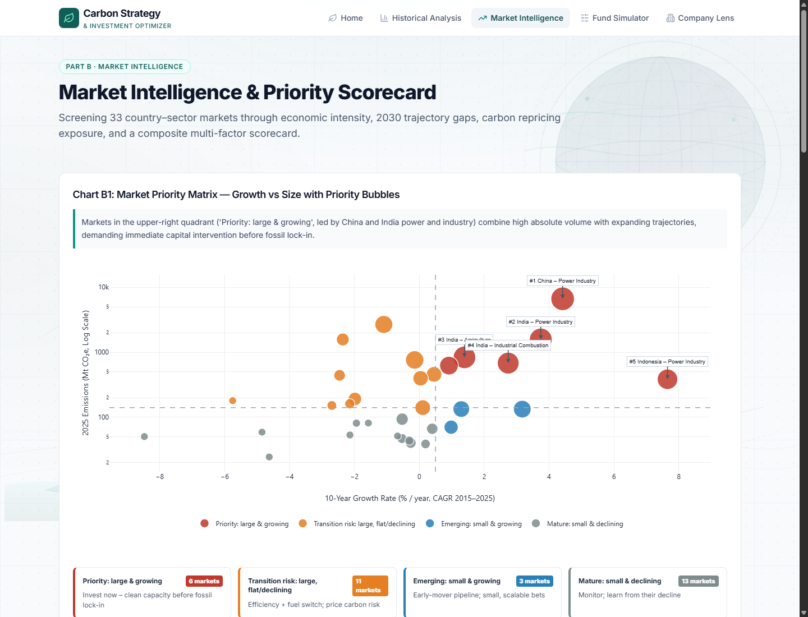
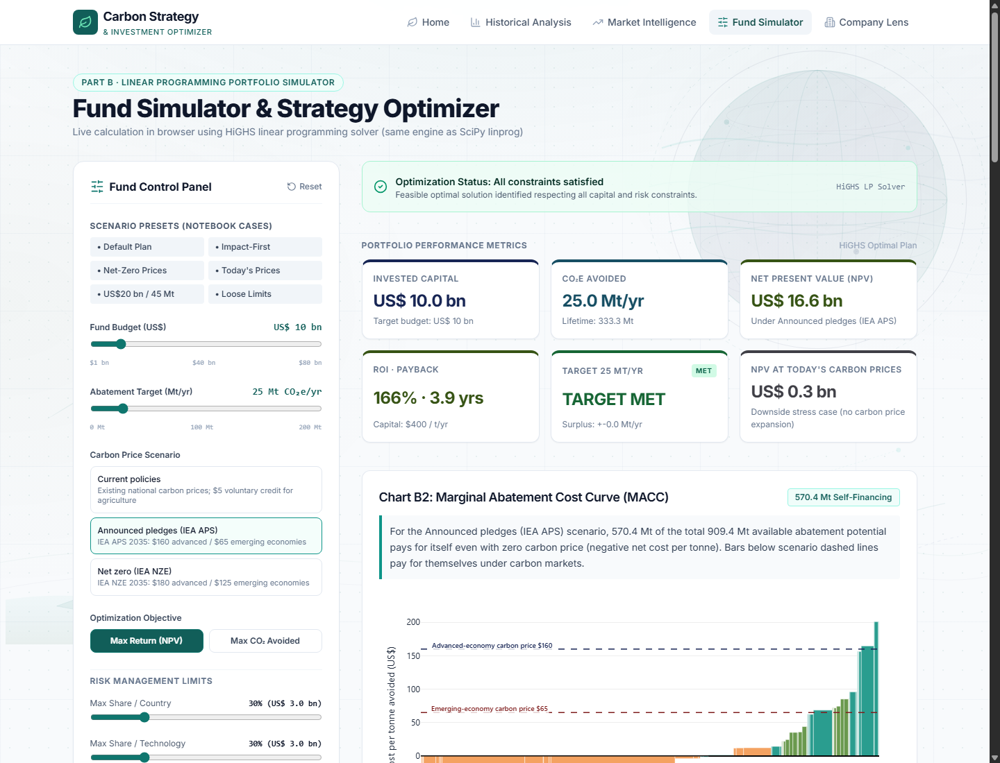

# Carbon Strategy & Investment Optimizer

**Interactive Web Portal & Climate Investment Fund Simulator**  
Built for university Introduction to Python Programming (IPP) coursework.

🔗 **Live Portal:** `https://carbon-strategy-optimizer.vercel.app`  
📓 **Python Source Notebook:** [`analysis/IPP_PROJECT_FINAL_simplified.ipynb`](analysis/IPP_PROJECT_FINAL_simplified.ipynb)  
📄 **Executive Report:** [`docs/IPP_Project_Report_Final.docx`](docs/IPP_Project_Report_Final.docx)  
🗺️ **Chart & Model Lineage:** [`docs/CHART_SOURCES.md`](docs/CHART_SOURCES.md)

---

## Executive Summary & Purpose

The **Carbon Strategy & Investment Optimizer** bridges academic climate-data analysis and strategic capital deployment. The portal allows students, professors, and fund managers to inspect 35 years (1990–2025) of EDGAR greenhouse-gas emissions data across 11 key economies and 3 critical sectors, and interactively allocate a **US$10 billion illustrative climate investment fund**. Using a pure-client-side linear programming optimizer (HiGHS compiled to WebAssembly), the application calculates optimal capital allocations that maximize financial Net Present Value (NPV) while achieving an annual abatement target of at least 25.0 Mt CO₂e under real-world concentration and risk limits.

### Problem Statement

> **"How have emissions changed across Agriculture, Industrial Combustion and Power Industry in 11 countries from 1990 to 2025, and how should a US$10 billion climate investment fund allocate its capital across these countries and sectors to avoid at least 25 million tonnes of CO₂e a year at the best financial return, within its risk limits and under uncertain future carbon prices"**

- **Part A: Historical Analysis (Notebook Cells 1–10):** Rigorous data cleaning, quality auditing, and 8 visual perspectives exploring emissions trends, structural shifts, and country trajectories.
- **Part B: Capital Allocation Engine (Notebook Cells 11–23):** An illustrative US$10 billion climate investment fund optimizing financial returns and carbon impact across 80 candidate projects spanning 33 country–sector markets. Risk guardrails include: max 30% per country, max 30% per technology, min 20% per sector.

**Default Benchmark Result:** US$10 bn budget → **25.0 Mt CO₂e/yr avoided**, **NPV ≈ US$16.6 bn** (ROI ≈ 166%, payback ≈ 3.9 years) under IEA announced-pledge carbon prices. Under current spot prices, NPV drops to US$0.3 bn. Pure return-seeking capital directs only 13% of funding to developing economies (India, Indonesia, Brazil, South Africa); enabling concessional finance and carbon border adjustments raises that share to ~60%.

> ⚠️ **Mandatory Methodological Caveat:** National sector emissions are **not** company emissions. We use national figures to size markets and systemic opportunities, never as an individual enterprise's carbon footprint. The fund is illustrative, and non-power project costs represent planning assumptions. This portal does not constitute investment advice.

---

## Portal Walkthrough & Screenshots

### 1. Headline Intelligence & Historical Analysis
*Interactive sectoral breakdown, country trajectories, bump rankings, and 1990–2025 Power Industry emission race.*



### 2. Market Priority Matrix (Chart B1)
*Evaluation of 33 country–sector markets by 10-year momentum, 2025 absolute emissions scale, and composite priority scorecard.*


### 3. Interactive Fund Simulator (Charts B2–B5)
*Real-time linear programming solver showing Marginal Abatement Cost Curve (MACC), capital allocation, strategy comparisons, and carbon-price stress testing.*


---

## Portal Structure & Graph Policy

In strict accordance with project requirements, **Part A** reproduces all historical charts faithfully from the Python notebook, while **Part B** features **exactly five charts** across the entire application to maintain executive clarity:

| Route | Content & Visual Deliverables | Notebook Reference |
|---|---|---|
| `/` | Headline KPIs (Power share, 2030 gap, default plan returns), problem statement, framework | Cells 4, 15, 18 |
| `/history` | All 8 Part A historical charts (Quality table, donut + ranked bar, faceted grid, treemap, bump chart, diverging change bars, small multiples, animated race) | Cells 3–10 |
| `/markets` | **Chart B1: Market Priority Matrix**, sortable market profiles, live World Bank API integration, 2030 trajectory gap, carbon exposure | Cells 12–16 |
| `/simulator` | **Chart B2: MACC**, **Chart B3: Capital Allocation**, **Chart B4: Strategy Comparison**, **Chart B5: Carbon-Price Stress Test**, KPI cards, interactive controls, 7 preset scenarios, downloadable allocation CSV | Cells 11, 17–21 |
| `/company` | Enterprise Decarbonization Lens: footprint calculator, trajectory gap, carbon tax liability, actionable interventions (KPIs & tables only) | Cell 22 |

---

## Architecture & Data Flow

```
[EDGAR GHG / World Bank / IEA]
              │
              ▼
analysis/IPP_PROJECT_FINAL_simplified.ipynb
              │
              ▼ (export_portal_data.py)
/data/*.json (Precomputed metrics, constants, reference benchmarks)
              │
   ┌──────────┴──────────┐
   ▼                     ▼
Next.js 14 App        HiGHS WASM Solver
(React / Tailwind)    (lib/model.ts in-browser LP)
   │                     │
   └──────────┬──────────┘
              ▼
Interactive Visuals (Plotly.js + React)
```

- **Framework:** Next.js 14 (App Router) with TypeScript and Tailwind CSS.
- **Client-Side Optimization Engine:** `highs` WebAssembly solver running compiled HiGHS C++ linear programming algorithms directly in the user's browser (0ms backend latency).
- **Visualization:** `plotly.js-dist-min` and `react-plotly.js` loaded dynamically with `{ ssr: false }`.
- **Integrations:** Real-time World Bank Open Data API (`SP.POP.TOTL`, `NY.GDP.MKTP.CD`) with automatic graceful fallback to stored values.
- **Verification:** Unit tests written in `vitest` asserting parity against SciPy reference outputs.

---

## Local Development & Testing

### Prerequisites
- Node.js 18+ and `npm`

### Setup & Run
```bash
# Clone the repository
git clone https://github.com/dharmic-js/carbon-portal.git
cd carbon-portal

# Install dependencies
npm install

# Run automated tests against Python notebook reference outputs
npm test

# Start development server
npm run dev
# Open http://localhost:3000 in your browser
```

### Production Build
```bash
npm run build
npm start
```

---

## Data Sources & Citations

1. **European Commission JRC:** EDGAR Community GHG Database (EDGAR_2026_GHG) and *GHG emissions of all world countries – 2026*.
2. **World Bank:** *State and Trends of Carbon Pricing 2026*; World Bank Open Data API.
3. **International Energy Agency (IEA):** *Global Energy and Climate Model Documentation 2025*; Cost of Capital Observatory.
4. **IRENA:** *Renewable Power Generation Costs in 2024*.
5. **Ember via Our World in Data:** Yearly electricity carbon intensities.
6. **IPCC AR6:** Working Group III (mitigation costs) and Synthesis Report (1.5 °C pathway).

---

## Team & Academic Attribution

- **Course:** Introduction to Python Programming (IPP), 2026
- **Team:** Anuj Gupta · Dhruv Malhotra
- **Faculty Instructor:** `[Instructor]`
- **License:** Code under MIT License. Primary datasets retain original open licenses (CC BY 4.0 for EDGAR).
